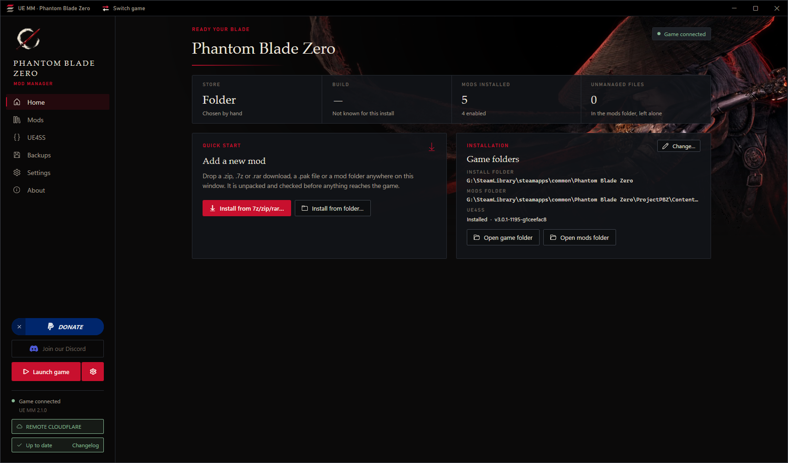

# UE MM

A mod manager for Unreal Engine games: **Black Myth: Wukong** and **Phantom Blade Zero**, and **Stellar Blade: Blood
Rain** as a preview of its look until the game is out. One app for every game: you pick the game, and the app takes its
look.

## What it does

- Installs mods from a `.zip`, `.7z` or `.rar` download, a `.pak` file or a mod folder: drop it on the window. Every
  download is unpacked and checked first, and nothing inside it is ever run.
- Handles pak mods (`.pak`, `.utoc` + `.ucas`), Blueprint mods (`LogicMods`), UE4SS Lua and DLL mods, and for Black
  Myth: Wukong mods for the C# Loader.
- Enables, disables, updates and uninstalls mods. It keeps its own copy of every mod and records a checksum for every
  file it places. Files it did not place are never overwritten or removed.
- Installs and updates UE4SS for the game, and shows the UE4SS log with its errors and warnings.
- Changes nothing while the game runs, and keeps the settings you changed in a mod's `config.lua` across updates.
- Backs up your saves each time it starts the game, or at a click: keep the backups you want for good, and give each
  a note, such as "Before the final boss".
- **Reset modding** takes the game back to its original files in one step, so you can start clean.
- Starts the game with the launch options you set; Black Myth: Wukong starts with `-fileopenlog`, which its pak mods
  need.
- Speaks English, Simplified Chinese (简体中文), Traditional Chinese (繁體中文) and Vietnamese (Tiếng Việt): choose in
  **Settings ▸ Language**.

## Screenshots



## How to install

1. Install the [.NET 8 Desktop Runtime (x64)](https://dotnet.microsoft.com/download/dotnet/8.0) if you do not have it.
2. Download `uemm_<version>.zip`, one zip for every game, from the latest
   [release](https://github.com/KintaroModding/uemodmanager/releases/latest).
3. Unzip it into a folder you can write to, for example `Documents\UE MM`, not `C:\Program Files`.
4. Start `UEModManager.exe` and choose your game. It finds the game through Steam or the Epic Games Launcher; otherwise
   choose the game folder in Settings. **Switch game** in the title bar changes the game at any time.

The app is portable: it keeps everything in a `Data` folder next to the exe.

**Update:** the app checks for a new version at every start and can update itself.

**Remove:** use **Settings → Reset modding…** first, so the game is back to its original files, then delete the app's
folder.

## How to use

- **Home:** drop a download on the window, or use **Install from 7z/zip/rar…**. A review shows what goes where
  before anything reaches the game.
- **Mods:** turn mods on and off, update or uninstall them, and edit or reset a mod's settings.
- **UE4SS:** install or update UE4SS, open its folder, and read its log.
- **Backups:** back up your saves, choose how many the app keeps, keep some for good in **Personal**, and restore one.
- **Settings:** the game folder, and the manager's data, logs and backups. **Reset modding…** removes every mod and
  UE4SS from the game; you choose whether the mods also leave the manager. **Report a problem…** makes a report for
  the help channel on Discord.

## Compatibility

- Black Myth: Wukong and Phantom Blade Zero, on Steam, on the Epic Games Store where the game is sold there, or in a
  folder chosen by hand. Stellar Blade: Blood Rain shows its look only, until the game is out.
- Your game is missing? In the game picker, **Missing your game? Tell us on Discord** scans its folder and makes a
  report to share.
- Windows 10 or 11, 64-bit.

## Known issues

- No load order yet: neither pak priority nor UE4SS's `mods.txt` order.

## How to build

On Windows, with the [.NET 10 SDK](https://dotnet.microsoft.com/download/dotnet/10.0) (version 10.0.100 or a later
feature band, pinned in `global.json`), from the repository root in PowerShell:

```powershell
./publish.ps1
```

It runs the tests and builds the release file `dist/release/uemm_<version>.zip`, and the same zip under the name older
versions of the app look for. The zip holds one `UEModManager.exe` for every game, a single file that needs the .NET 8
Desktop Runtime. To build only the app:

```powershell
dotnet publish src/UEManager.UI/UEManager.UI.csproj -c Release -o dist/app
```

## Credits

- KintaroModding: creator and maintainer. Every contributor is named in `CONTRIBUTORS.md` and on the app's About page.
- [CommunityToolkit.Mvvm](https://github.com/CommunityToolkit/dotnet),
  [SharpCompress](https://github.com/adamhathcock/sharpcompress) and
  [AvalonEdit](https://github.com/icsharpcode/AvalonEdit), all MIT.
- [UE4SS](https://github.com/UE4SS-RE/RE-UE4SS), which the app installs for the game.

License: GNU General Public License, version 3, with additional terms in `NOTICE.md`.
